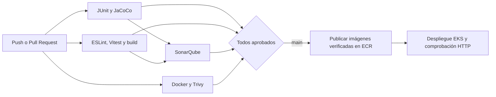

# EP2 - Ingeniería DevOps (DOY0101)


Repositorio de entrega: https://github.com/Martin-ignaxiiooo/devops-segunda-prueba

Aplicación base: Gestor de Alumnos del [laboratorio del profesor](https://github.com/mauriciovelasquezduoc/202602Devops01/). Utiliza Spring Boot 4 / Gradle / Java 21, React / Vite y PostgreSQL 16. Los datos iniciales son ejemplos del laboratorio.

## Estado y evidencias

Aplicación desplegada en AWS Academy Learner Lab:

**http://ac4ea9fb00ed74430bff6c139b708c3e-1588630464.us-east-1.elb.amazonaws.com**

La [primera ejecución completa aprobada](https://github.com/Martin-ignaxiiooo/devops-segunda-prueba/actions/runs/40450427650) construyó, verificó, publicó y desplegó las tres imágenes. La [página del workflow](https://github.com/Martin-ignaxiiooo/devops-segunda-prueba/actions/workflows/ci-cd.yml) muestra las ejecuciones posteriores y sus artefactos.

Resultados comprobados el 27 de octubre de 2026:

- Backend: 35 pruebas (incluidos siete escenarios BDD y dos controles negativos CSRF); JaCoCo supera los umbrales de 80%.
- Frontend: 73 pruebas aprobadas y cobertura de líneas de 100%.
- SonarQube: puerta de calidad aprobada, cobertura global de 98,1%, cero bugs y cero vulnerabilidades en esa ejecución.
- Trivy: las tres imágenes aprobaron el umbral HIGH/CRITICAL con corrección disponible.
- Kubernetes: frontend 2/2, backend 2/2, PostgreSQL 1/1, PVC EBS Bound y métricas de CPU disponibles para el HPA.
- Verificación funcional en AWS: creación y edición desde la interfaz; importación, exportación CSV y eliminación de un registro temporal mediante la API.

La [ejecución inicial bloqueada](https://github.com/Martin-ignaxiiooo/devops-segunda-prueba/actions/runs/40447441479) conserva evidencia de que los hallazgos de seguridad impidieron desplegar. Las correcciones se integraron mediante el [Pull Request 20](https://github.com/Martin-ignaxiiooo/devops-segunda-prueba/pull/20).

El entorno es un laboratorio con datos ficticios, HTTP y una sesión temporal de AWS Academy. La disponibilidad depende de mantener activo el Learner Lab.

## Estructura

- `backend/`: API CRUD y CSV, pruebas JUnit, Mockito e integración.
- `frontend/`: interfaz React y 73 pruebas Vitest.
- `database/`: imagen PostgreSQL y datos de ejemplo.
- `.github/workflows/ci-cd.yml`: integración y despliegue en un único repositorio.
- `.github/dependabot.yml`: actualizaciones Gradle, npm, Docker y Actions.
- `infra/eks.yaml`: recursos AWS EKS y ECR.
- `k8s/`: despliegues, servicios, almacenamiento, escalado y políticas de red.
- `scripts/`: inspección de AWS, renderizado y verificación del despliegue.

## Ejecución local

Requisitos: Docker Desktop operativo. Copia `.env.example` a `.env` y configura una contraseña local distinta de la usada en AWS.

```sh
docker compose up --build --wait
```

La interfaz queda en http://localhost:8081. PostgreSQL y la API se acceden dentro de la red de Compose; el proxy del frontend expone `/ep02`.

```sh
docker compose down
```

El volumen de datos se conserva al detener Compose.

## Pipeline y trazabilidad



El SHA completo del commit, número de ejecución e intento identifican las tres imágenes. Cada intento utiliza una etiqueta distinta para permitir reintentos con ECR inmutable. CI guarda la imagen que pasó Trivy y deploy publica ese mismo archivo, sin reconstruirlo. ECR utiliza etiquetas inmutables. Los deployments incorporan la anotación `ep02.duoc/commit`; los artefactos de Actions registran el commit, la ejecución y los recursos desplegados.

Los pull requests ejecutan controles y no despliegan. Un fallo en pruebas, cobertura, SonarQube o Trivy impide el job de despliegue. La rama de integración es `main`.

## Pruebas y cobertura

Backend (Java 21):

```sh
cd backend
./gradlew test jacocoTestCoverageVerification --no-daemon
```

JaCoCo exige al menos 80% de instrucciones y 80% de ramas. En Windows se utiliza `gradlew.bat`.

Frontend (Node 22):

```sh
cd frontend
npm ci
npm run lint
npm run test:coverage
npm run build
```

Vitest exige al menos 90% de líneas, ramas, funciones y sentencias. Los reportes locales están en `backend/build/reports/` y `frontend/coverage/`; CI los publica como artefactos.

## Seguridad

Dependabot revisa dependencias y acciones semanalmente, con actualizaciones agrupadas. El grafo Gradle se publica desde el workflow de dependencias; npm también se audita en cada ejecución de CI, incluyendo dependencias de desarrollo. Un SonarQube temporal en el runner analiza Java y JavaScript. Su puerta de calidad bloquea bugs, vulnerabilidades y cobertura global inferior al 80%. `sonar.qualitygate.wait=true` obliga a esperar el resultado y transmite el fallo al pipeline. El servidor y su token de analisis solo viven durante ese job, y no requieren una cuenta externa. El administrador temporal cambia su clave inicial por una clave aleatoria antes de analizar.

Trivy inspecciona las tres imágenes y bloquea hallazgos HIGH o CRITICAL con corrección disponible. Los hallazgos sin corrección quedan fuera de ese umbral; esto no equivale a afirmar que una imagen no tiene vulnerabilidades.

No se guardan credenciales en Git. `.env`, `.local/`, `.tools/` y `secrets.txt` están excluidos. La clave de PostgreSQL se inyecta como Secret de Kubernetes. Backend y frontend utilizan usuarios sin privilegios; las políticas de red restringen el ingreso hacia base de datos y backend. Su aplicación requiere el soporte de NetworkPolicy del CNI, configurado en la infraestructura.

Spring Security mantiene CSRF habilitado para la SPA: el GET inicial emite la cookie `XSRF-TOKEN` y Axios la envía como `X-XSRF-TOKEN` en las escrituras. Las solicitudes sin token o con uno inválido reciben HTTP 403. Los clientes de API deben obtener primero la cookie con un GET y conservarla al enviar el encabezado.

La API del ejemplo no implementa autenticación de usuarios: utiliza solo datos ficticios y mantenla dentro del alcance del laboratorio.

## AWS Academy Learner Lab

La infraestructura utiliza el rol `LabRole` existente, dos subredes de la VPC predeterminada en diferentes zonas y EKS 1.35 con nodos AL2023. Antes de crear recursos se comprueba que la versión siga en soporte estándar. La cuenta debe permitir esos servicios y el rol debe conservar los permisos y relaciones de confianza necesarios.

Instala `boto3` y configura las credenciales temporales del Learner Lab mediante el mecanismo de credenciales de AWS. Nunca las pegues en un commit.

```sh
python scripts/bootstrap-aws.py
```

El comando anterior inspecciona y valida; no crea recursos. Después de revisar el plan y presupuesto:

```sh
python scripts/bootstrap-aws.py --create
```

La creación de EKS puede tardar varios minutos. Cuando el nodo esté activo, configura el acceso y el controlador de almacenamiento del laboratorio:

```sh
aws eks wait cluster-active --region us-east-1 --name ep02-devops
aws eks wait nodegroup-active --region us-east-1 --cluster-name ep02-devops --nodegroup-name ep02-nodes
aws eks update-kubeconfig --region us-east-1 --name ep02-devops
kubectl patch deployment ebs-csi-controller -n kube-system --type merge --patch-file infra/ebs-csi-lab-patch.json
kubectl rollout status deployment/ebs-csi-controller -n kube-system --timeout=180s
aws cloudformation wait stack-create-complete --region us-east-1 --stack-name ep02-devops
```

Estas operaciones requieren AWS CLI y kubectl. Configura `EKS_CLUSTER_NAME=ep02-devops` como variable de Actions y estos secretos:

| Secreto | Uso |
|---|---|
| `AWS_ACCESS_KEY_ID` | Credencial temporal del laboratorio |
| `AWS_SECRET_ACCESS_KEY` | Credencial temporal del laboratorio |
| `AWS_SESSION_TOKEN` | Token temporal del laboratorio |
| `DB_PASSWORD` | Contraseña de PostgreSQL |

Renueva los tres valores AWS al cambiar la sesión. Un token vencido debe producir un fallo de autenticación; no se omite la seguridad para continuar.

El frontend se expone por un servicio `LoadBalancer`; el pipeline espera su dirección pública y verifica tanto la interfaz como `/ep02`. La URL queda en el resumen y en `deploy-evidence`. PostgreSQL y el backend conservan servicios internos. Como alternativa de diagnóstico desde una terminal con acceso al clúster:

```sh
aws eks update-kubeconfig --region us-east-1 --name ep02-devops
kubectl port-forward -n ep02 service/ep02-frontend 8081:80
```

Abre http://localhost:8081. El pipeline comprueba HTTP y la consulta de alumnos mediante este mismo servicio.

## Orquestación y datos

PostgreSQL mantiene una réplica y un volumen EBS gp3 de 2 GiB. Su política de recuperación `Retain` conserva el volumen ante la eliminación del PVC; debe inventariarse al limpiar el laboratorio porque sigue consumiendo almacenamiento.

El backend inicia con dos réplicas y un HPA de dos a tres, al 70% de CPU. El frontend inicia con dos réplicas. Todos tienen límites de memoria y CPU, sondas de salud y reinicio gestionado por Kubernetes. El clúster inicia con un nodo; el máximo de dos del nodegroup es un límite de tamaño, no un autoscaler de nodos. El HPA requiere Metrics Server. La persistencia requiere EBS CSI. El parche `infra/ebs-csi-lab-patch.json` configura una réplica del controlador EBS en la red del nodo, para que utilice el rol EC2 `LabRole` en este laboratorio sin crear roles IAM. Se limita al componente de almacenamiento; las aplicaciones conservan la red normal de pods. El pipeline aplica y comprueba este ajuste antes del despliegue.

EKS y el almacenamiento pueden generar cargos aunque la sesión del laboratorio termine. La eliminación debe planificarse después de registrar las evidencias y conservar los datos necesarios. Este repositorio no ejecuta borrados automáticos sobre la cuenta.

## Evidencias de evaluación

| Indicador | Archivos | Comprobación pendiente o disponible |
|---|---|---|
| IE1 | Dockerfiles y `.dockerignore` | Tres builds y escaneos de imagen aprobados; usuarios sin privilegios |
| IE2 | Pruebas backend y frontend | Pruebas backend y 73 frontend, con cobertura y controles CSRF |
| IE3 | Dependabot, SonarQube, Trivy, límites y políticas | Puerta de calidad aprobada y ejecución bloqueada conservada como evidencia |
| IE4 | Pipeline, imágenes SHA y script deploy | Despliegue EKS aprobado, URL pública y artefactos de trazabilidad |
| IE5 | `k8s/`, PVC, probes, HPA | Rollouts correctos, cinco pods de aplicación y volumen persistente Bound |

## Uso de IA

Se utilizó Codex de OpenAI como apoyo para revisar la pauta, adaptar la aplicación del laboratorio a este repositorio, preparar configuraciones de CI/CD y analizar resultados de pruebas. El equipo debe revisar y validar el contenido y registrar el uso final de IA conforme a la [orientación de Duoc](https://bibliotecas.duoc.cl/ia).

## Integrantes

Completar los nombres de ambos integrantes antes de entregar.

## Conclusiones y reflexión de cada integrante

Pendiente: cada integrante debe escribir su propia reflexión sobre aprendizaje y contribución, sin apoyo de IA, además de las conclusiones y justificaciones técnicas que la pauta reserva al equipo. Este apartado no se completa automáticamente.
